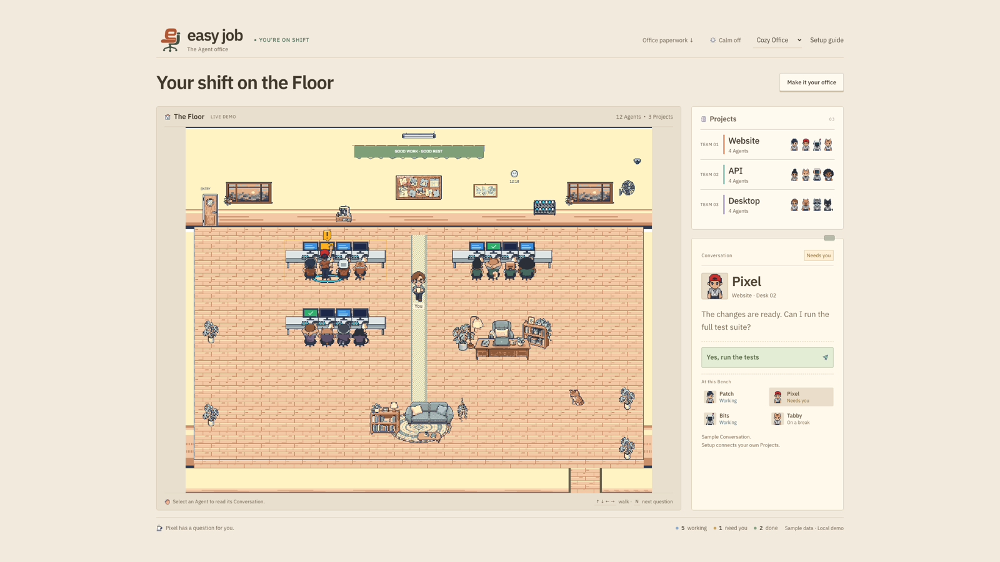

<p align="center"></p>

# easy job · The Agent office

Easy Job shows what [Orcha](https://github.com/trungkien1208/orcha) is running as a pixel-art office. Each Orcha
workspace is a Bench and each Agent sits at a Desk. You walk the Floor as the Boss and answer whoever raised a hand.



A blue monitor means the Agent is working, a raised hand means it needs you, and a green screen means it is done.
Click an Agent to read its Conversation, answer its Question or give it the next task. It all runs on your machine.

## Notices from the Floor

Each Orcha workspace becomes a Project, and its Agents sit together at one Bench in the Project's colour. Four
Desks make a Bench, and an Agent keeps its Desk for as long as it runs.

When an Agent raises a hand, read its Question and send an Answer or pick one of the options it offers. It goes
back to work. Press `n` to jump to the next raised hand.

A finished Agent stays on the attention list until you look at it. Opening it marks the finish as Seen, and the
Agent goes idle in Orcha as well.

Walk the Boss around with WASD, the arrow keys or clicks. Knock to Nudge an idle Agent, Bonk to interrupt one (it
asks first), or use the megaphone to Broadcast one Prompt to a whole Project.

When an Agent ends, two HR bouncers carry it out. Live Agents keep their Desks. Exit interviews are unusually
brief.

Each Agent also gets a chat (Claude, Codex or Cursor) with its files, git changes and remaining fuel next to it.
From the composer you can change its model, effort and Fast mode, switch it to another account, or hand the
conversation to a new Agent. New Agents and Projects start from the same page.

## Office rules

1. Everything stays on this machine. Easy Job listens on 127.0.0.1 with a per-run token, needs no account, sends no
   telemetry and makes no internet requests while it runs.
2. Stopping work always asks first. Removing an Agent or closing a Project needs a confirmation. The gags (buzzer,
   zap, coffee, high-five) are animations and never reach an Agent.
3. Calm mode stills the Floor: it pauses motion, gags and sound.

The office comes in two themes, Cozy Office and Compound.

## Install

### With Orcha

Orcha offers Easy Job when you install or update it. Say yes, then press `prefix E` or run `orcha office`. To add it
later:

```bash
orcha plugin install trungkien1208/orcha-plugin-office --ref plugin
```

You do not need Bun for this. The plugin downloads the prebuilt `easy-job` for your machine (macOS arm64 or x64,
Linux x64 or arm64) from the matching release and checks its sha256. When a new Easy Job is out, Orcha tells you;
click Update there or run `orcha plugin update easy-job`.

If you don't have Orcha yet:

```bash
curl -fsSL https://raw.githubusercontent.com/trungkien1208/orcha/HEAD/install.sh | sh
```

### From the source

From the Easy Job project folder, with [Bun 1.4+](https://bun.sh/):

```bash
bun install
bun run install-local      # builds the web app, compiles ~/.local/bin/easy-job, runs doctor
easy-job                   # start the office (or reuse the running one) and open it
```

`install-local` downloads nothing. It builds `packages/web/dist`, compiles a single `easy-job` executable into
`~/.local/bin` that runs without Bun, and copies the web build next to it as `easy-job-web`. `~/.local/bin` has to be
on `PATH`.

Easy Job works with Orcha 0.9.12 and later and speaks Orcha socket protocols 22 to 24. On an older Orcha it leaves
out the newer features: the model catalog, structured questions and account switching through Orcha. If Orcha is
not running, the page says so and offers a Start Orcha button.

## Commands

| Command | Does |
|---|---|
| `easy-job` | Start the bridge if none is running, then open the browser. Running it again reuses the same bridge. |
| `easy-job serve [--no-open] [--port N] [--session NAME] [--new-token]` | Run the bridge in the foreground. |
| `easy-job open [--via-orcha]` | Open the browser, starting the bridge in the background if needed. |
| `easy-job stop` / `easy-job status` | Stop the bridge / show what it sees. |
| `easy-job doctor` | Check Orcha, the socket, protocol, transcripts, the data folder and the art, with a fix for each problem. |
| `easy-job autostart on\|off` | Start the bridge at login (macOS). |
| `easy-job orcha-plugin install\|uninstall` | Link this checkout into Orcha as a plugin (for development). |

## How it fits together

Orcha runs the terminals, agents and accounts. Easy Job is a client of Orcha's local socket API and never changes
Orcha. The `easy-job` bridge, written for Bun, keeps one connection to Orcha, turns its state into the office and
serves the web app (React, with the Floor drawn in Phaser) and one WebSocket on 127.0.0.1. It reads transcripts from
the files your agents already write and does not copy them anywhere.

Agent text is rendered as Markdown without raw HTML. The page token lives in `~/.easy-job/token` (mode 600) and
survives bridge restarts, so open tabs reconnect; `--new-token` rotates it. The bridge rejects requests with a
foreign `Origin` or a non-local `Host`, and it never logs tokens or transcript text.

`~/.easy-job/` (mode 700) holds Seen marks, skins, Desk memory, the Activity log, uploads, logs, `bridge.json` and
`token`. Activity and uploads are kept for 7 days.

## Development

```bash
bun run dev:fake     # the whole app on a fake Orcha with sample Agents: safe for trying actions
bun run dev          # bridge plus Vite with hot reload, against your real Orcha
bun run check        # tsc + Biome + unit tests
bun run test:e2e     # Playwright against the fake Orcha
```

`packages/shared` has the types and helpers both sides use, `packages/bridge` the bridge and CLI, and
`packages/web` the app. The Floor lives in `packages/web/src/floor` and only takes props. `CONTEXT.md` defines the
domain words (Project, Agent, Bench, Boss, Nudge, Bonk, Broadcast, Seen and the rest), and `docs/adr/` records the
decisions.

Art comes from `packages/web/public/office/manifest.json`, and `docs/art-brief.md` is the brief for new art.
`bun scripts/smoke-live.ts` runs one short real Claude session in a scratch workspace against your Orcha. It is
manual and not part of `check`.

### Releasing

Bump `version` in `package.json` and push a tag `vX.Y.Z`. CI checks the tag against the version, builds every
platform with `bun run release`, publishes the GitHub release with `SHA256SUMS`, and rewrites the `plugin` branch
that Orcha installs from. `bun run release --only darwin-arm64` builds one platform locally. The full plan is in
`docs/plan-release.md`.

Easy Job is a local client for Orcha.
